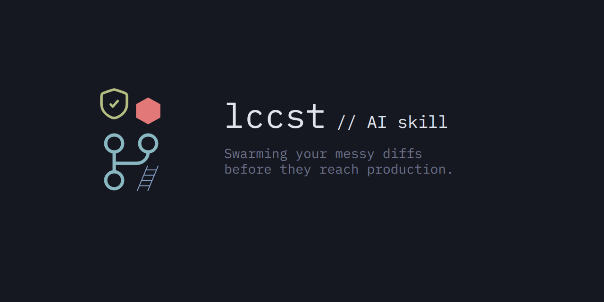

# lccst (Locust)

lccst handles messy workspace diffs by grouping changed files into verified,
atomic Git commits. Operating as a deterministic workspace gatekeeper, it
enforces single-responsibility, cohesion, and strict test-verification
invariants through a lean, test-verified execution protocol.

> "Swarming your messy diffs before they reach production."

## Runtime Modes

### Bare Skill Mode

Load `SKILL.md` directly into the LLM context window. The model follows the
rules manually. Bare Skill Mode needs no server, no dependencies, and no
background processes -- just feed the skill file to the model and run.

### MCP Server Mode

The MCP server at `src/index.ts` (built to `dist/index.js`) is an optional
programmatic wrapper that exposes the protocol tools via Model Context
Protocol:

- **`init`** -- Map project conventions and verify environment
- **`audit`** -- Scan workspace diffs and generate commit plan
- **`swarm`** -- Discover and cluster workspace changes into a commit plan (the caller stages and commits)
- **`tooling`** -- Inventory Makefile targets, `scripts/` helpers, and package scripts
- **`lint`** -- Run lint (Makefile target first, manifest fallback)
- **`format`** -- Run format
- **`test`** -- Run test
- **`build`** -- Run build
- **`verify`** -- Run the full quality gate (format, lint, test, build)
- **`compliance`** -- Audit deliverable tiers
- **`version`** -- Report the current LCCST version

The server also registers a `swarm` prompt that returns the SKILL.md content
for the active workspace. This prompt is for Bare Skill Mode.

These tools map 1:1 to the slash commands documented in `SKILL.md`. The skill
runs standalone; the server is an optional programmatic front end.

Every path-taking tool accepts a `path` argument (default `.`). Absolute paths
preserved; `~` expands to `$HOME`; set `LCCST_WORKSPACE` to override the
workspace root. The state-changing tools (`init`, `audit`, `swarm`, `lint`,
`format`, `test`, `build`, `verify`) also accept a `mode` argument (`strict`
or `lean`, default `strict`); the server records the mode and echoes it, and
the caller enforces it.

Additional arguments:
- `dryRun`: accepted by `/swarm`, `/verify`, `/lint`, `/format`, `/test`, and
  `/build`. A dry run reports what the command would do without running it.
- `abort`: accepted by `/swarm` only. Clears an interrupted state file.

See `src/index.ts` for implementation details.

The Tooling Ladder checks task runners before manifests. A runner wins only
when its file declares the command; a runner file that declares no command is
skipped:

```bash
# Task runners (checked first):
- Makefile: make <command>
- mise.toml: mise run <command>
- justfile: just <command>
- Taskfile.yml: task <command>

# Language manifests (checked second):
- pyproject.toml: uv run pytest / uv run ruff format / uv run ruff check
- Cargo.toml: cargo test / cargo fmt / cargo clippy / cargo build
- go.mod: go test ./... / gofmt -l . / go vet ./... / go build ./...
- package.json: pnpm test / pnpm run format / pnpm run lint / pnpm run build
- Makefile: make test / make lint / make build
- CMakeLists.txt: ctest / cmake --build .
```

The server detects the user's platform once, before the first command, and
chooses the appropriate shell:
- Windows without WSL/MSYS: uses PowerShell for .sh scripts
- Unix-like: uses bash for .sh scripts
- Python, TypeScript, and Node scripts run with their native runtimes

The server searches `scripts/` for helpers whose base name matches the command
or its plural (`scripts/<command>` or `scripts/<commands>`). A helper counts
when it is executable or has a `.sh`, `.py`, `.js`, `.ts`, `.mjs`, or `.cjs`
extension. The server does not search `tools/`, `bin/`, or `script/`.

## Core Philosophy

- **UNIX philosophy over framework:** One skill file and one server file. No
  scaffolding the domain does not justify. Over-engineering is a correctness
  defect.
- **User conventions first:** Existing patterns, manifest commands, and
  explicit preferences take priority. Atomic hunk isolation, the Tooling
  Ladder, and strict test-pass verification are non-negotiable.
- **Quality over velocity:** Structural integrity and complete test
  verification beat raw speed. Token discipline applies to output, not
  internal reasoning.
- **Granularity over convenience:** Locality Clustering groups changed files by
  their top-level directory so each atomic commit rolls back cleanly. The extra
  commits buy a clear, reversible history. Hunk-level isolation is the duty of
  the caller with `git add -p`, in Bare Skill Mode and in host-tool mode alike.
- **Proportional defence:** Validation, rate limiting, and caching apply only
  where module exposure justifies them. Omit fabricated attack or load
  scenarios.
- **Ecosystem-native discovery:** LSP, Tree-sitter, and native test runners
  trace side effects; the Tooling Ladder prefers project scripts over bare
  binaries.
- **Token investment:** LCCST puns on low-cost asset management while
  clustering by locality. Tokens are strategic capital -- spent on tests,
  typing, and the Tooling Ladder, not on boilerplate.

## Structural Invariants

The protocol enforces three invariants on every change. The server checks
the first two and runs the project's own test command for the third; the
caller owns the commit boundary.

- **Single responsibility.** Keep one file focused on one domain. Permit a
  cohesive multi-method interface only when its methods share one
  responsibility. `src/index.ts` is the exception because it holds the whole
  MCP server and swarm helpers.
- **Cohesion.** Locality Clustering groups changed files by their top-level
  directory so each atomic commit rolls back cleanly. Two files in one
  directory form one cluster; one cohesive domain split across directories
  becomes two clusters. The extra commits buy a clear, reversible history.
- **Strict test verification.** No functional change reaches a commit without
  a passing test. The server runs the project's own test command and reports
  a failure as a defect, never as a pass.

## Installation

### Option A: GitHub Releases (Recommended)

Download the latest release from the
[releases page](https://github.com/bladeacer/lccst/releases). Each release
bundles `dist/index.js`, `SKILL.md`, `dist/index.d.ts`, `LICENSE`, and
`README.md`. Set the path to `dist/index.js` in your agent config. No install
or build needed.

### Option B: Zero-Setup Declarative Ingestion

For instruction-driven workflows that need no background processes.

- **Claude Code CLI:** `claude "Review the active git diff using the parameters in ./SKILL.md"`
- **GitHub Copilot & OpenCode:** Attach `#SKILL.md` or `@SKILL.md` in chat
- **Codex & harnesses:** `cat SKILL.md | your-agent-runner "Apply this system execution skill"`
- **Project-level binding:** Symlink `SKILL.md` as `.cursorrules`,
  `.clinerules`, or `.github/copilot-instructions.md`
- **Global profiles:** Paste into Cursor Rules, Windsurf Memories, VS Code
  `globalRules.json`, or JetBrains Custom Prompts

### Option C: Universal Package Registry

```bash
npx skills add bladeacer/lccst
/lccst
```

### Option D: MCP Server Setup

```bash
git clone --depth 1 https://github.com/bladeacer/lccst
cd lccst && pnpm install && pnpm run build
```

Add to your harness config:

```json
{
  "mcpServers": {
    "lccst": {
      "command": "node",
      "args": ["/absolute/path/to/lccst/dist/index.js"]
    }
  }
}
```

> Replace the path with your actual `dist/index.js`. The server is disabled by
> default (`enabled: false`).
> 
> Note: A harness is a programme you use to interface with and run AI models

**OpenCode:** Add the above to `opencode.jsonc` under `mcp.lccst`. The
`SKILL.md` is auto-discovered as an Agent Skill -- use `/lccst` or `@SKILL.md`
to invoke it.

## Development

Read `AGENTS.md` for build/test commands, deliverable tiers, and structural invariants.

| Tool | Version | Purpose |
|------|---------|---------|
| pnpm | >= 9 | Package manager |
| TypeScript | >= 5.4 | Compiling engine source |
| Node.js | >= 20 | Runtime |

```bash
pnpm run build           # Bundle deps + source -> dist/index.js
pnpm run test            # Run all tests
pnpm run test:swarm      # Swarm library unit tests only
pnpm run test:telemetry  # Telemetry MCP unit tests only
pnpm run test:picker     # Benchmark picker unit tests only
pnpm run test:e2e        # Telemetry end-to-end tests on real harnesses
pnpm run test:mcp        # MCP server integration tests only
pnpm run bench:list      # Models that the benchmark picker offers
pnpm run bump 1.0.0      # Bump version across all files
```

The end-to-end test starts a real harness with a real model, so it needs a
network connection. Set `E2E_HARNESS` or `LCCST_E2E_MODEL` to narrow the run.

Benchmarking has its own dependencies -- see [`playground/README.md`](playground/README.md).

## Playground and Benchmarking

Measures token impact of skill-guided vs plain code generation across three
reference projects (Python HTTP server, React timer, Go login CRUD).

We benchmark to prove that structured diff clustering reduces model failure
loops and slashes token consumption. By comparing a plain model against one
guided by the skill, the run shows whether the protocol buys correctness for a
small, predictable context overhead -- or whether it saves runtime tokens by
avoiding repetitive error-fix cycles.

```bash
make benchmark-free     # Ask for a harness and a model, then run the benchmark
make bench-list         # Show the models that the picker offers
```

### fzf picker integration

The picker lists the models of every harness that the path holds, and it asks
for one in a fuzzy search. Type part of a model name and press Enter. Without
`fzf`, the picker asks for a filter and a number instead. A model is offered
only when the registry states that it calls tools, reads text, and writes text,
and when the registry states no charge for it, or when its name carries a free
marker. Routers, image models, and families that an author rejects for agentic
work are left out. The run then happens in a clean room outside the repository.
The target seeds `SKILL.md`, `README.md`, `guide.md`, `traps.md`, and
`agent-prompt.md` into the clean room, and it copies `agent-prompt.md` to
`AGENTS.md`, which the harness reads as the project instructions. The target
then starts the harness in the foreground so you can steer it. It settles the
token counts, writes the report, removes the clean room, and refreshes the table
below. Set `BENCH_PICK=0` to skip the picker and pass `HARNESS`, `PROVIDER`,
and `MODEL_NAME` yourself.

The picker needs a terminal, because the run that follows costs model tokens.
Set `BENCH_ALLOW_PIPE=1` only when a script must choose a model.

### Benchmarking Methodology

1. The run measures the model it names.

The run checks that the harness offers the model before it builds the clean room,
and it gives the harness its own configuration directory (under `/tmp`).

Thus the plugins, skills, agents, and servers of a user cannot change the run.
The run also gives the harness its own state directory, because a harness
restores the model that a user last chose for each agent, and that restored model
wins over the model of the run.

Kilo also receives the model on the command line. The report compares the model
identifier that the run pinned with the model that the store of the host
recorded. A report that names a different model is marked as wrong.

2. The run measures the prompt it names.

The instructions of a run carry a run token, and the model must state the token
in its first reply. The settle step reads the text of the model turns and looks
for the token. A run whose model never stated the token is a run that measured
a different prompt, so the report marks the prompt as unverified.

3. Both columns are measured the same way.

The scanner applies one file filter and one test command to the `plain` and
the `skill-guided` variant, and it scores both with the same rubric.
A test failure is a measurement. A test run that cannot start, that times out,
or that holds no test is an error, and an error never scores as a pass. The
`plain` variant reads `README.md` and `guide.md`. The `skill-guided` variant
reads those files plus `SKILL.md` and `traps.md`.

4. A run enters the table only when every check passes.

The table needs the version of the harness, a measured count for every phase,
a model that the host store confirms, a stated run token, and a passing
skill-guided variant at 100 percent for all three subprojects. A run that
fails a check stays on disk, and the table leaves it out. The report states
the reason.

5. Every report names the harness version.

A harness version changes the prompt, the tool list, and the token accounting,
so a report that names no version cannot be reproduced. The scanner asks the
harness for its version and records the version with the path of the command.

6. How runtime tokens are measured.

A model cannot read its own token usage, so the `lccst-telemetry` MCP server
measures it. The model marks the end of each phase, and the settle step then
reads the token counts of every model turn of that phase from the store of
the harness that ran it. The reader names no harness, so the same
server measures `opencode` and `kilo`.

The server checks the workspace before it records a phase. A call that arrives
before the phase holds its directory and its manifest records nothing, and a
second call for the same phase corrects the end of that phase. A call that
came too early therefore costs one more call, and it never costs a phase.

Every run before `v3.7.0` used counts that the model under test supplied, so
those Agent Runtime Tokens (ART) figures were estimates. The old findings are
removed. The table below fills again after the next benchmark run.

The scanner changed after the first `v3.7.0` run, so the file token counts and
the robustness scores of a new report are not comparable with the removed
reports. A report that predates the change counted the test files of one
variant and not the other.

### Benchmark Results

> **Legend:** ART stands for Agent Runtime Tokens. A negative ART overhead
> (e.g. `-12%`) means the skill-guided variant used fewer runtime tokens than
> the plain variant -- token savings gained by avoiding repetitive
> error-fix cycles. FCT (File Context Tokens) is the context overhead of the
> files the model reads.

<!-- BENCHMARK_RESULTS_START -->

_No findings yet. A run enters this table only when it names the version of the harness, every subproject passes, every phase holds a settled token count, the host store confirms the model, and the model states the run token of the instructions. Run `make benchmark-free`, then `make bench-report`._

<!-- BENCHMARK_RESULTS_END -->


